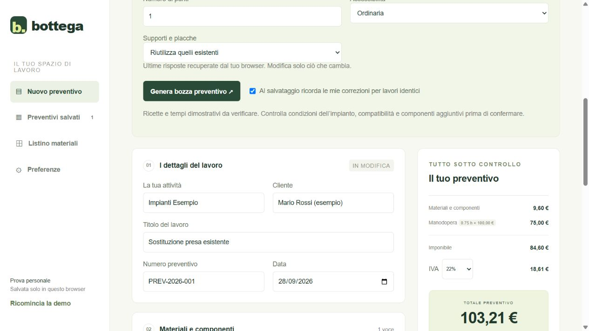

# Bottega — Il tuo preventivo pronto all’uso

Prototipo di gestionale per elettricisti: partire da un lavoro, ottenere una proposta di materiali e manodopera, correggerla e preparare un preventivo.

**[Prova la demo senza registrarti](https://bottega-portfolio.andrea-perrone1990.chatgpt.site)** · [Decisioni di prodotto e limiti](docs/PRODUCT.md)



## Il problema
Preparare un preventivo richiede di ricostruire materiali, quantità e ore, recuperare prezzi e trasformarli in un documento. Bottega esplora un flusso basato su lavorazioni precompilate, mantenendo modificabili le decisioni del professionista.

## Cosa puoi provare
- Tre ricette: sostituzione presa, interruttore e apparecchio illuminante.
- 18 articoli sintetici e alternative economica, intermedia e costosa nei gruppi di esempio.
- Manodopera calcolata come ore × tariffa oraria.
- Prezzo di vendita dal listino oppure costo netto più ricarico percentuale.
- Importazione locale di file `.xlsx`, con anteprima e associazione delle colonne.
- Modifica, salvataggio, duplicazione e stampa dei preventivi.
- Memoria delle correzioni per configurazioni identiche e preferenze personali.
- Esportazione/importazione del backup e reset della demo.

## Una prova in due minuti
1. Scegli “Sostituzione presa esistente” e il numero di prese.
2. Premi “Genera bozza preventivo”.
3. Cambia le ore e confronta un’alternativa materiale.
4. Salva e riapri il preventivo dall’archivio, oppure stampalo.

## Stato del progetto
**Prototipo dimostrativo, non prodotto pronto per preventivi reali.** Prezzi, compatibilità e tempi sono sintetici. Le ricette devono essere validate da professionisti. La memoria è deterministica: non è un modello AI che apprende autonomamente. L’ordinamento delle alternative usa il costo netto; il prezzo al cliente può differire.

La demo pubblica conserva i dati solo nel `localStorage` del browser: non richiede account, non sincronizza dispositivi e non invia i preventivi a un database. Usa dati inventati. I dati rimangono sul dispositivo fino al reset o alla cancellazione dei dati del browser. La demo privata con account separati è un ambiente distinto e non è inclusa in questo repository.

## Avvio locale
Richiede Node.js 22.13 o successivo. Non serve installare dipendenze.

```sh
git clone https://github.com/andreaperrone1990-gif/Bottega-Il-tuo-preventivo-pronto-all-uso.git
cd Bottega-Il-tuo-preventivo-pronto-all-uso
npm start
```

Apri `http://localhost:4190`. Per eseguire i controlli del motore:

```sh
npm test
```

## Architettura
HTML, CSS e JavaScript senza framework per l’interfaccia; Node.js per server locale e test. ExcelJS 4.4.0 è incluso come asset per leggere gli Excel nel browser.

| File | Responsabilità |
| --- | --- |
| `dist/engine.js` | Ricette, scelta articoli, prezzi e totali |
| `dist/app.js` | Editor, archivio e stampa |
| `dist/electrician.js` | Listini Excel, preferenze e memoria |
| `dist/auth.js` | Avvio della demo e persistenza locale, senza autenticazione |
| `dist/portfolio.js` | Contesto dimostrativo, reset e riepilogo WebMCP |
| `test/` | Verifiche del motore e della validazione |

La cartella `dist/` contiene il sorgente statico pronto da ospitare; non richiede compilazione. `.openai/hosting.json` identifica la pubblicazione su Sites e non contiene credenziali. Il repository GitHub e la pubblicazione Sites sono aggiornati separatamente: il push su GitHub non distribuisce automaticamente il sito.

## Roadmap
- Ricette e compatibilità tecniche validate con elettricisti.
- Percorso guidato sul telefono e ore espresse anche in minuti.
- Più lavorazioni nello stesso preventivo e sola manodopera.
- Importazione dei listini più semplice e aggiornamenti reversibili.
- Distinzione tra correzioni occasionali e preferenze da ricordare.

Progetto sviluppato con assistenza di Codex. La documentazione distingue le funzionalità implementate dalle ipotesi da validare.

## Componenti di terze parti
ExcelJS è distribuito con la propria [licenza MIT](dist/vendor/EXCELJS-LICENSE). Nessun catalogo commerciale, documento cliente, database o credenziale è incluso. Non è assegnata una licenza open source al codice originale del progetto.
